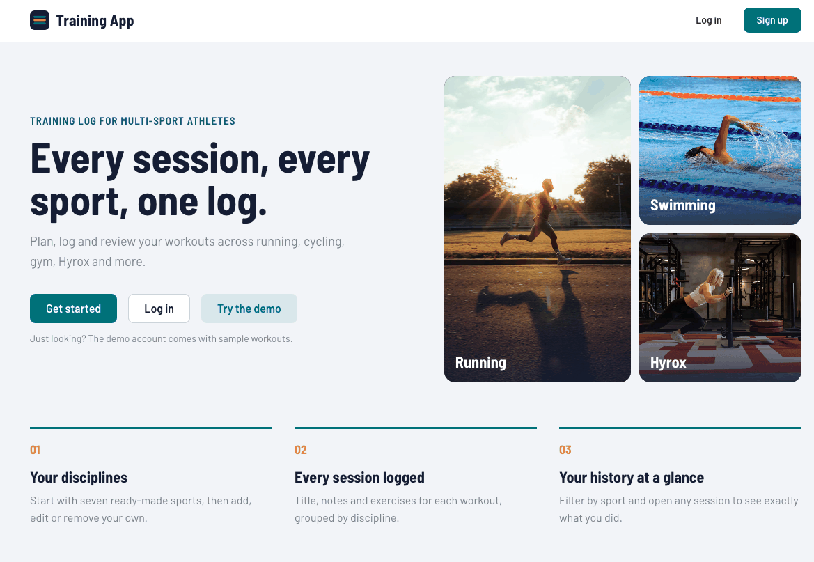
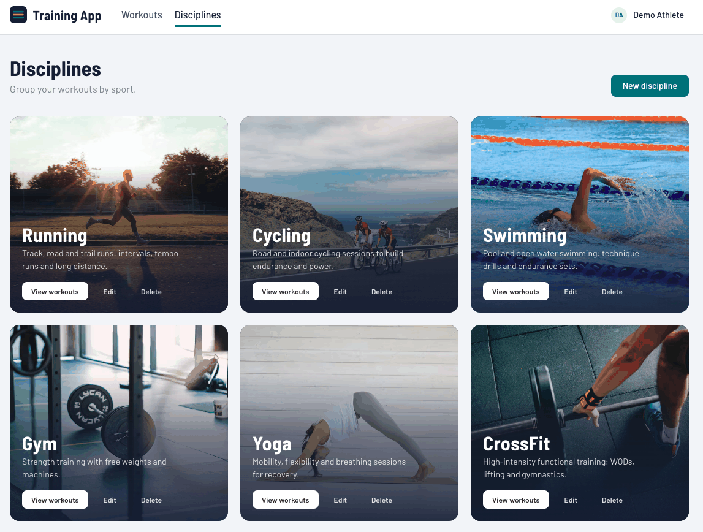
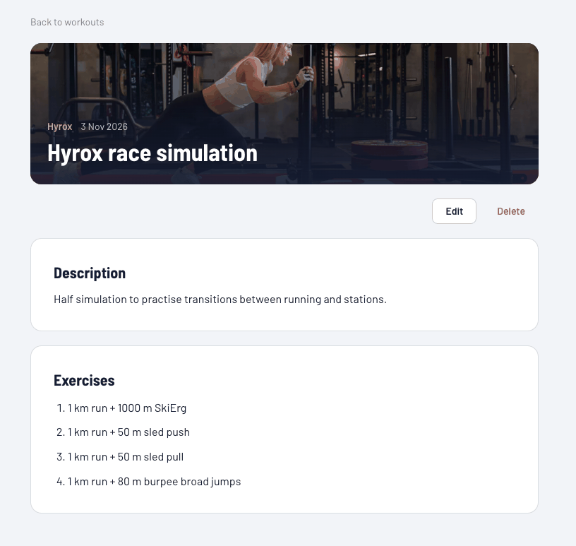

# 🏋️ Training App — Frontend

A full stack MERN app to plan, log and review your workouts across every discipline: running, cycling, swimming, gym, Hyrox and more.

**🔗 Live demo:** https://app-training.vercel.app/
**⚙️ Backend repo:** [Training App Backend](https://github.com/raulcarrasco8/Training-app-project-backend)

> 👀 **Just looking?** Click **Try the demo** on the home or login page to log in with sample data, or use `demo@trainingapp.dev` / `Demo1234`.



| Disciplines | Workout details |
|---|---|
|  |  |

---

## ✨ Features

- Sign up and log in with JWT authentication, plus a one-click demo account
- Home dashboard with your number of workouts, disciplines and latest session
- Disciplines shown as photo cards, with 7 ready-made ones for every new account
- Full CRUD for disciplines and workouts, with forms in modals
- Live image preview when adding a discipline, which blocks links that aren't images
- Filter workouts by discipline with chips (the filter lives in the URL, so it can be shared)
- Workout details with the discipline photo and a numbered list of exercises
- Loading skeletons, empty states and clear error messages
- Automatic logout and redirect to login when the session expires
- Responsive layout with a mobile menu

## 🛠️ Tech stack

| Layer | Technologies |
|---|---|
| Frontend | React 19, Vite, React Router, Mantine UI, Axios |
| Backend | Node.js, Express, MongoDB + Mongoose, JWT |
| Deployment | Vercel (frontend), Render (API) |

## 🧠 Technical decisions

- **Mantine with a custom theme:** one theme defines the colors (a deep teal and an amber accent) and fonts (Barlow), so every component looks consistent without writing CSS for each page. Custom CSS is kept for the few signature pieces, like the photo cards.
- **React Context for auth:** the logged-in user, the token and a shared `logIn()` live in a context, so the login form, signup and demo button use the same logic.
- **Session expiry in one place:** an Axios response interceptor catches `401` responses on authenticated requests, clears the session and shows a single notification. No page needs its own handling.
- **Route guards:** `IsPrivate` protects private pages and `IsAnon` keeps logged-in users out of login/signup, redirecting each case to the right page (`redirectTo`).
- **Reusable forms:** `WorkoutForm` and `DisciplineForm` are used for both create and edit, so validation and behaviour stay the same in both flows.
- **Filters in the URL:** the discipline filter is a query parameter (`?discipline=<id>`), so it survives a page reload and links can be shared.
- **Separate frontend and backend repos:** each codebase stays focused, and frontend and backend could be worked on independently.

## 🔮 What I'd improve today

- [ ] Add tests (Vitest + React Testing Library, Playwright for end-to-end)
- [ ] Set up CI with GitHub Actions
- [ ] Migrate to TypeScript
- [ ] Centralize API calls in one Axios instance instead of repeating the base URL and headers
- [ ] Split the bundle by route (`React.lazy`) to reduce the initial download

---

## 🚀 Run it locally

1. Clone the repo

```bash
git clone https://github.com/raulcarrasco8/Training-app-project-frontend
cd Training-app-project-frontend
```

2. Install dependencies

```bash
npm install
```

3. Create a `.env` file in the project root pointing to your local backend:

```env
VITE_API_URL=http://localhost:5005
```

4. Start the dev server

```bash
npm run dev
```

5. Open http://localhost:5173

The [backend](https://github.com/raulcarrasco8/Training-app-project-backend) must be running, with `ORIGIN` including `http://localhost:5173`.

## 📂 Project structure

```
src/
├── components/   # Navbar, cards, forms, route guards, demo button
├── context/      # Auth context (session, logIn, 401 interceptor)
├── pages/        # Home, auth, disciplines and workouts pages
├── theme/        # Mantine theme (colors and fonts)
├── utils/        # Helpers (date formatting, demo credentials)
├── App.jsx       # Layout and routes
├── index.css
└── main.jsx
```

## 👨‍💻 Author

**Raúl Carrasco** — [LinkedIn](https://www.linkedin.com/in/raul-webdeveloper/) · [GitHub](https://github.com/raulcarrasco8)
